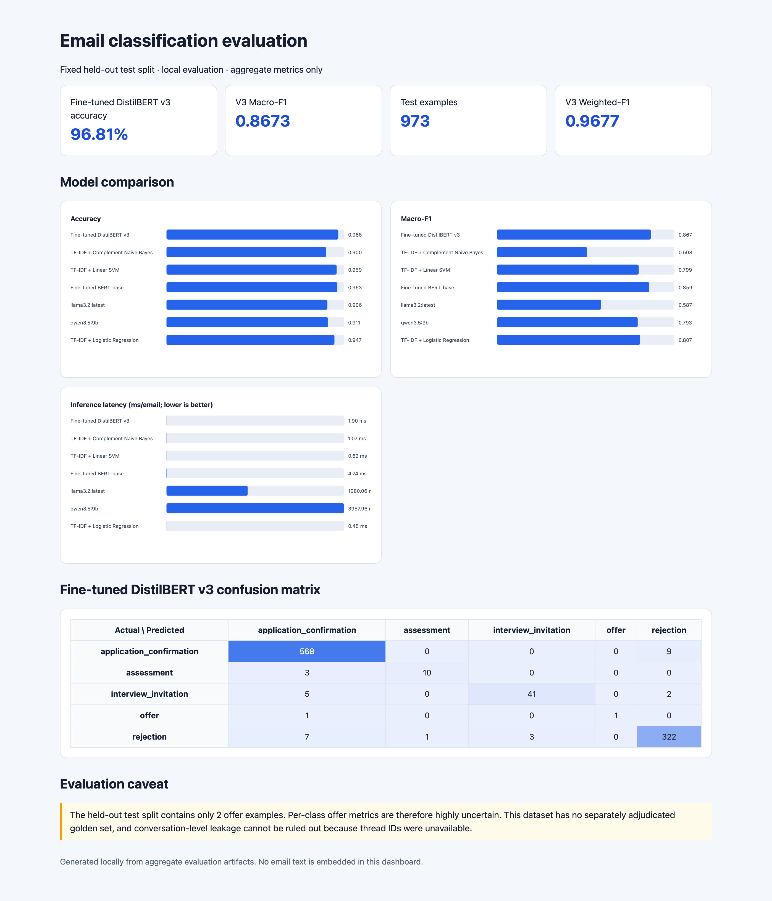
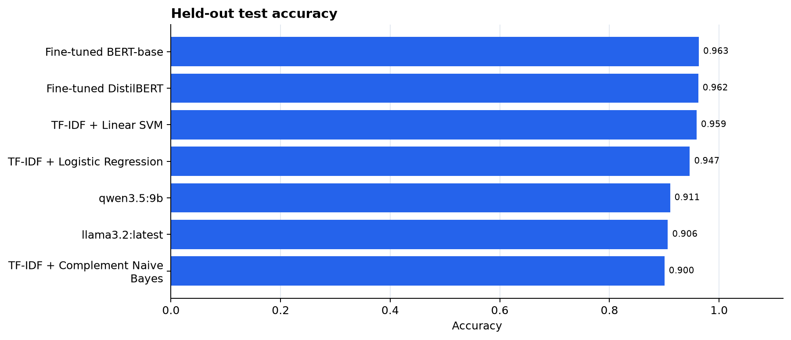
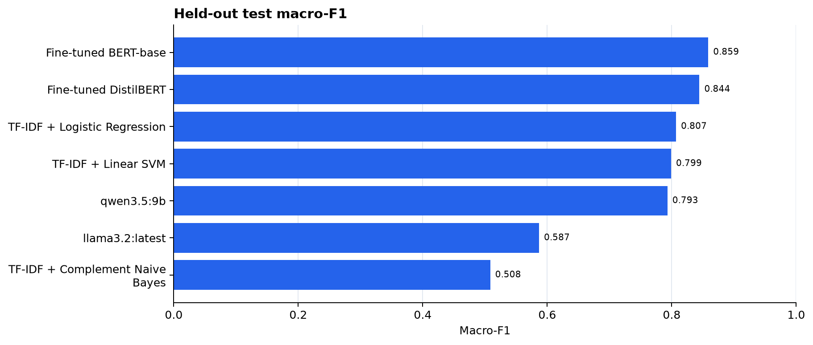
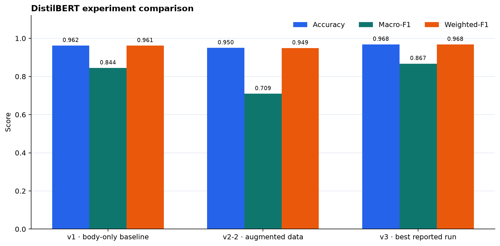
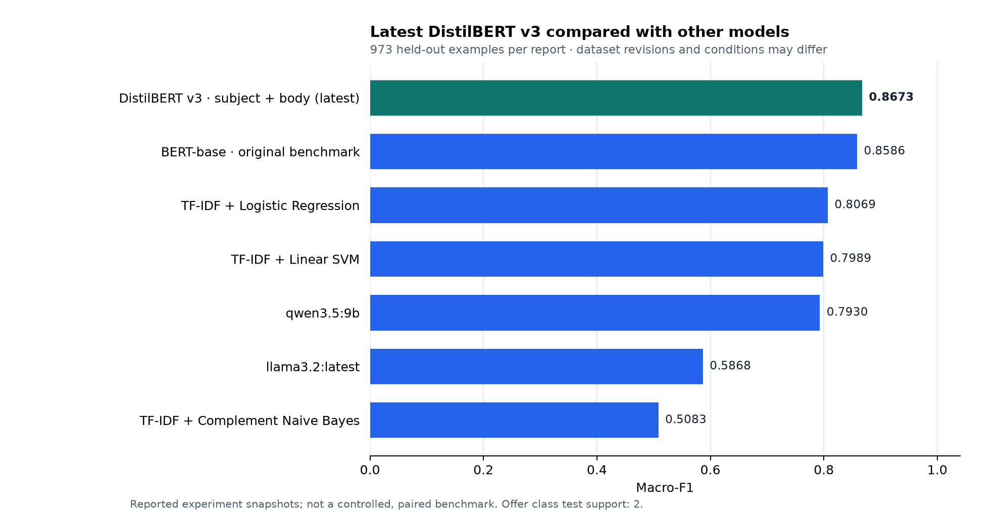
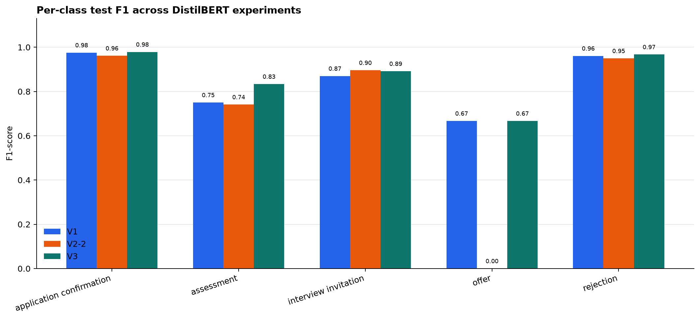

# Job email classifier

An NLP project for classifying job-search emails into application
confirmation, assessment, interview invitation, offer, and rejection. It
compares fine-tuned DistilBERT and BERT-base models, TF-IDF baselines, and
locally served Ollama models.

**[Open the interactive evaluation dashboard](portfolio/dashboard.html)**

The dashboard is a standalone HTML file and uses aggregate metrics only.
The latest DistilBERT iteration, v3, is the strongest reported run.

## Results

All models were evaluated on the same fixed held-out split of 973 emails.
Trainable models selected checkpoints using validation macro-F1.

| Model | Accuracy | Macro-F1 |
|---|---:|---:|
| Fine-tuned BERT-base | 0.963 | 0.8586 |
| Fine-tuned DistilBERT (original run) | 0.962 | 0.844 |
| TF-IDF + Linear SVM | 0.959 | 0.799 |
| TF-IDF + Logistic Regression | 0.947 | 0.807 |
| TF-IDF + Complement Naive Bayes | 0.900 | 0.508 |

These original results are single-run results, not a multi-seed benchmark.
The test split has only two offer examples, so offer metrics are highly
uncertain. The labels are project reference labels rather than an independently
adjudicated gold set. Thread IDs were unavailable, so conversation-level
separation between splits cannot be confirmed. The BERT-base checkpoint
emitted missing and unexpected LayerNorm-key warnings; validate those weights
before relying on that result.

## Model Evaluation Results — Latest Amendment

The project also evaluated later DistilBERT experiments on a held-out test set
of 973 emails.

### Latest best result

**DistilBERT — 96.81% accuracy and 0.8673 macro-F1**

The latest experiment supplied the email subject and body together as model
input and used the previous experimental dataset.

| Metric | Latest DistilBERT |
|---|---:|
| Accuracy | **0.9681** |
| Macro-F1 | **0.8673** |
| Weighted-F1 | **0.9677** |
| Validation macro-F1 | 0.8580 |
| Test examples | 973 |

This result exceeds the earlier BERT-base benchmark, which achieved 0.9630
accuracy and 0.8586 macro-F1.

### Model comparison

These are reported experiment results, not a fully controlled benchmark;
training data and evaluation conditions may differ across runs.

| Model / Experiment | Accuracy | Macro-F1 | Weighted-F1 |
|---|---:|---:|---:|
| **Latest DistilBERT (subject + body)** | **0.9681** | **0.8673** | **0.9677** |
| Previous BERT-base | 0.9630 | 0.8586 | 0.9600 |
| Previous DistilBERT | 0.9620 | 0.8440 | 0.9610 |
| TF-IDF + Linear SVM | 0.9590 | 0.7990 | 0.9580 |
| TF-IDF + Logistic Regression | 0.9470 | 0.8070 | 0.9460 |
| Llama 3.2 | 0.9060 | 0.5870 | 0.9100 |
| Qwen 3.5:9b | 0.9110 | 0.7930 | 0.9130 |
| TF-IDF + Complement Naive Bayes | 0.9000 | 0.5080 | 0.8900 |
| DistilBERT with expanded synthetic data | 0.9496 | 0.7094 | 0.9489 |

The expanded-data experiment introduced 47 additional synthetic offer emails
and 36 additional synthetic assessment emails. It did not improve the
reported overall macro-F1.

### Latest DistilBERT per-class results

| Category | Precision | Recall | F1-score | Support |
|---|---:|---:|---:|---:|
| Application confirmation | 0.9726 | 0.9844 | 0.9785 | 577 |
| Assessment | 0.9091 | 0.7692 | 0.8333 | 13 |
| Interview invitation | 0.9318 | 0.8542 | 0.8913 | 48 |
| Offer | 1.0000 | 0.5000 | 0.6667 | 2 |
| Rejection | 0.9670 | 0.9670 | 0.9670 | 333 |

**Evaluation caveats:** The test set contains only two offer examples and 13
assessment examples. Minority-class metrics are therefore highly uncertain.
The first synthetic augmentation experiment and the latest experiment use
different dataset revisions, so their results should not be interpreted as a
controlled test of augmentation alone. The previous BERT-base result also
remains provisional because of missing/unexpected LayerNorm-key warnings.

See the [interactive evaluation dashboard](portfolio/dashboard.html) for the
confusion matrices and aggregate results.

### Additional experiments

Two additional DistilBERT experiments investigated supplying subject and body
together:

- **Expanded-data experiment:** Added 47 synthetic offer and 36 synthetic
  assessment examples. Achieved 0.9496 accuracy and 0.7094 macro-F1.
- **Previous-dataset experiment:** Used the previous dataset with subject and
  body together. Achieved 0.9681 accuracy and 0.8673 macro-F1, establishing
  the project's best reported result.

See [MODEL_CARD.md](MODEL_CARD.md) for intended use, evaluation context, and
limitations.

## Engineering highlights

- Fine-tuning and evaluation pipelines for DistilBERT and BERT-base, with
  checkpoint selection by validation macro-F1.
- Classical TF-IDF baselines and optional local Ollama comparisons using
  aggregate metrics.
- Duplicate and conflicting-label cleanup before deterministic,
  label-stratified splitting; identical normalized subject/body pairs are
  kept together.
- Prebuilt synthetic offer and assessment examples are added only to the
  training split; split creation does not generate examples at runtime.
- Synthetic data quality checks flag duplicates and potential label overlap;
  an optional local Ollama judge assesses realism and label fit.
- V2-2 and v3 combine subject and body with explicit `Subject:` and `Email:`
  prefixes; the original v1 DistilBERT run used the body only.
- Unit tests for split generation and synthetic data; GitHub Actions runs
  them on pushes and pull requests.
- Privacy-conscious evaluation artifacts: no email text or row-level
  predictions are embedded in the public dashboard.

## Privacy

The public showcase contains aggregate results and visualizations only. It
does not include message text, row-level predictions, credentials, or model
checkpoints.

## Project code

- `train.py` — DistilBERT fine-tuning and held-out evaluation
- `compare_models.py` — classical baselines, BERT-base, and optional Ollama evaluation
- `predict.py` — local inference with the saved DistilBERT checkpoint
- `portfolio/dashboard.html` — standalone HTML evaluation dashboard
